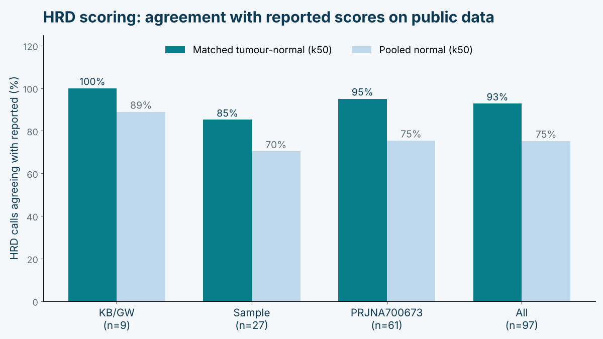

Homologous recombination deficiency (HRD) predicts benefit from PARP inhibitors and platinum chemotherapy, most of all in ovarian cancer. The genomic-scar score adds three counts of copy-number events: loss of heterozygosity (HRD-LOH), telomeric allelic imbalance (TAI) and large-scale state transitions (LST). Patients are usually called HRD-positive at a sum of 42 or more.

This pipeline computes the score from tumour sequencing:

- **Allele-specific copy number** with `sequenza-utils bam2seqz` (50 bp GC wiggle, 50 bp binning) and Sequenza 3.0.0.
- **Scoring** with scarHRD 0.1.1, at gamma 60 / kmin 50 (the scarHRD default) with kmin 10 as a cross-check.
- **Two modes:** matched tumour-normal, with genotypes taken from the patient's own normal, and tumour-only against a pooled normal.
- **Runs as** a Nextflow DSL2 workflow or a standalone Bash runner, plus a script that computes agreement metrics against reference scores.

## Validation on public data

I scored 97 tumours from three public cohorts and compared each with its published HRD-sum: 9 KB/GW standards and 27 tumour-normal pairs from PRJNA850105 (Wei et al., *Mol Oncol* 2023), and 61 whole exomes from PRJNA700673 (Kang et al., *Cancer Res* 2022).

| Analysis (all 97 tumours) | Calls agree | Sensitivity | Specificity | Cohen's κ | Lin's CCC | Mean abs. difference |
|---|---|---|---|---|---|---|
| Matched, kmin 50 | 90/97 | 0.92 | 0.96 | 0.81 | 0.966 | 4.8 |
| Matched, kmin 10 | 92/97 | 0.95 | 0.96 | 0.86 | 0.964 | 4.6 |
| Pooled normal, kmin 50 | 73/97 | 0.73 | 0.83 | 0.45 | 0.723 | 14.9 |

Every tumour that the matched pipeline called differently from the published result had a published score between 39 and 48, so scores of roughly 35–50 should be treated as borderline.

## Two findings that change the score

1. **The Sequenza version matters.** Sequenza 4.0.0 accepts scarHRD's `gamma` and `kmin` arguments but silently ignores them, because its segmentation no longer uses them. On the standards, this compressed high scores: the mean gap to published scores was 16 points with Sequenza 4 and 10 with Sequenza 3, and high-HRD tumours were underestimated by 24 and 12 points on average. The pipeline refuses to run on Sequenza 4 or later.
2. **A pooled normal is not a substitute for a matched normal.** Sequenza takes heterozygous SNPs from the normal sample, and a pool of other people's normals cannot tell it which sites are heterozygous in this patient. On the WES cohort, pooled-normal scores ran about 15 points low, and elsewhere the errors went in both directions.

The code, the validation table for every cohort and the metric definitions are in the [repository](https://github.com/bioinfosourabh/hrd-scoring).
